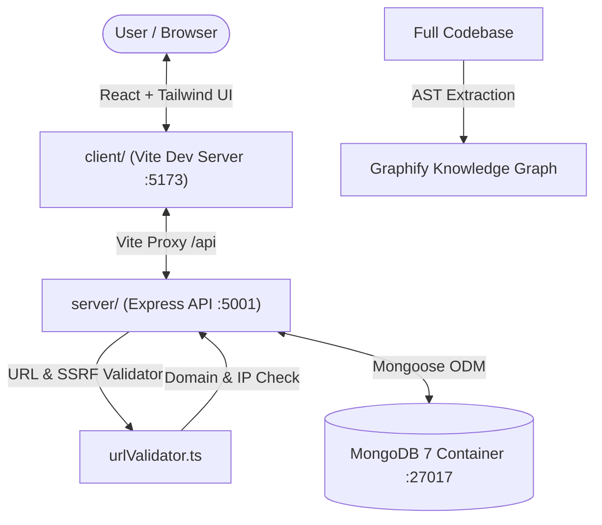

# SAVEit

> **Share once. Extract automatically. Find it later in seconds.**

SAVEit is an AI-powered personal knowledge library that turns shared **Instagram Reels** and **YouTube Shorts** into organized, searchable knowledge. Instead of letting valuable technical tutorials, tools, libraries, and tips disappear into crowded social feeds, SAVEit preserves the original source link, extracts structured knowledge (summaries, code, and mentioned tools), and makes it retrievable in seconds.

---

## 1. Problem & Core Solution

Short-form videos are a primary channel for discovering modern developer tools, coding tricks, design assets, and productivity workflows. However:
* **Crowded feeds:** Bookmarked videos are buried under entertainment and algorithms.
* **Scattered context:** Knowledge is split across spoken audio, captions, on-screen terminal text, and description links.
* **Manual note-taking friction:** Taking manual notes while watching a 30-second Reel breaks the user flow.

**SAVEit's Philosophy:**
1. **Preserve Immediately:** When you submit a URL, SAVEit saves the original source record first before attempting any downstream processing.
2. **Honest Processing States:** Never claim a video was fully analyzed when only basic metadata was accessible. Distinguish full media analysis, transcript-only results, metadata-only fallbacks, and platform access limitations.
3. **Zero Security Compromise:** Strict input validation and proactive Server-Side Request Forgery (SSRF) defenses prevent malicious intranet or metadata probing.

---

## 2. Architecture & Walking Skeleton (Phase 1)

Milestone 1 establishes the end-to-end "walking skeleton" connecting the frontend interface, backend API, validation engine, and containerized database:



### Monorepo Structure
```text
SAVEit/
├── .planning/                  # GSD living memory, requirements, roadmap, and plan summaries
│   ├── PROJECT.md
│   ├── REQUIREMENTS.md
│   ├── ROADMAP.md
│   ├── STATE.md
│   └── phases/01-core-foundation-url-capture/
├── client/                     # Frontend Application (React 18 + Vite + Tailwind CSS v4)
│   ├── src/
│   │   ├── components/         # Header, UrlCaptureBar, StatusBadge, ItemCard, LibraryFeed
│   │   ├── services/           # Typed API service (api.ts)
│   │   ├── types/              # Knowledge models and status contracts (item.ts)
│   │   ├── App.tsx             # Root application coordinator
│   │   ├── index.css           # Tailwind v4 theme and glassmorphic card utilities
│   │   └── main.tsx            # DOM root entry
│   ├── package.json
│   └── vite.config.ts          # Vite configuration with backend proxy
├── server/                     # Backend API Service (Node.js + Express + TypeScript)
│   ├── src/
│   │   ├── config/             # Mongoose connection & graceful shutdown (db.ts)
│   │   ├── controllers/        # Item CRUD & health handlers (itemController.ts)
│   │   ├── models/             # Mongoose Item schema with 7 honest states (Item.ts)
│   │   ├── routes/             # Express route declarations (itemRoutes.ts)
│   │   ├── utils/              # SSRF defense & URL parsing (urlValidator.ts)
│   │   ├── app.ts              # Express application factory
│   │   └── index.ts            # HTTP server bootstrap & graceful termination
│   ├── tests/                  # Automated test suites (Vitest + Supertest)
│   │   ├── api.test.ts         # Endpoint integration tests
│   │   ├── itemStorage.test.ts # Live MongoDB CRUD & deduplication tests
│   │   └── urlValidator.test.ts# SSRF & platform parsing unit tests
│   ├── package.json
│   └── tsconfig.json
├── docker-compose.yml          # Containerized MongoDB 7 with healthcheck
├── package.json                # Root npm workspace orchestration
└── README.md                   # Project documentation & developer guide
```

---

## 3. The 7 Honest Processing States

A core architectural principle of SAVEit is **transparency**. Rather than providing binary "success" or "failure" indicators, SAVEit tracks items through 7 distinct, color-coded states:

| Status Code | UI Badge | Meaning & Trigger Condition |
| :--- | :--- | :--- |
| `queued` | **Queued** (Amber Clock) | URL submitted and safely stored; waiting for retrieval worker. |
| `full_analyzed` | **Full Analysis** (Emerald Check) | Both spoken audio and visual frames were legitimately accessible and analyzed. |
| `partially_analyzed` | **Partial** (Cyan Circle) | Only some evidence streams (e.g., audio transcript but no video stream) were accessible. |
| `metadata_only` | **Metadata Only** (Purple Tag) | Media streams were restricted; basic author, title, and source link preserved. |
| `needs_user_input` | **Needs Input** (Orange Alert) | Platform requires authorized token or user-supplied transcript. |
| `retryable_failure` | **Retryable** (Rose Refresh) | Temporary network timeout or platform rate limit encountered; item preserved for retry. |
| `unsupported_inaccessible` | **Inaccessible** (Gray Lock) | Content is private, deleted, or blocked by platform anti-bot mechanisms. |

---

## 4. Security & SSRF Defense

When an application accepts URLs from users to perform server-side fetching, it is vulnerable to **Server-Side Request Forgery (SSRF)**. Malicious inputs can cause the server to probe internal networks, database ports, or cloud instance metadata.

SAVEit implements proactive validation in [`server/src/utils/urlValidator.ts`](file:///home/syed-imadulla/Desktop/SAVEit/server/src/utils/urlValidator.ts) before any network socket is opened:
* **Protocol Whitelist:** Only `http:` and `https:` are permitted (`file:`, `ftp:`, `javascript:`, and `data:` are blocked).
* **Loopback & Private Network Interception:** Hostnames resolving to `localhost`, `127.0.0.0/8`, `::1`, RFC 1918 subnets (`10.0.0.0/8`, `172.16.0.0/12`, `192.168.0.0/16`), and carrier-grade NAT (`100.64.0.0/10`) are rejected immediately.
* **Cloud Metadata Defense:** Blocks link-local addresses such as AWS/GCP metadata endpoint `169.254.169.254`.
* **Domain Whitelist & Normalization:** Strictly permits Instagram (`instagram.com`, `instagr.am`) and YouTube (`youtube.com`, `youtu.be`), stripping tracking queries (`?igsh=...`, `?si=...`) into canonical URLs for clean deduplication.

---

## 5. Technology Stack & Prerequisites

* **Node.js:** `>= 20.0.0`
* **npm:** `>= 10.0.0`
* **Docker & Docker Compose:** Installed and running (for local MongoDB)
* **Frontend:** React 18, Vite, TypeScript, Tailwind CSS v4, Lucide Icons
* **Backend:** Node.js, Express, TypeScript, Mongoose, Zod
* **Database:** MongoDB 7.0 (official container)
* **Testing:** Vitest, Supertest
* **Codebase Intelligence:** Graphify

---

## 6. Step-by-Step Quickstart

### 1. Clone the repository and install dependencies
```bash
git clone <repo-url> SAVEit
cd SAVEit
npm install
```

### 2. Configure environment variables
Copy the example environment file:
```bash
cp .env.example .env
```
*(Default settings point to `http://localhost:5001` for the backend and `mongodb://localhost:27017/saveit` for MongoDB).*

### 3. Start local MongoDB container
```bash
npm run db:up
```
Verify the container is healthy:
```bash
docker ps --filter "name=saveit-mongodb"
```

### 4. Start the full-stack development environment
Run both the Express backend and the Vite frontend concurrently in a single terminal:
```bash
npm run dev
```
* **Frontend App:** [http://localhost:5173](http://localhost:5173)
* **Backend API:** [http://localhost:5001](http://localhost:5001)

### 5. Run the automated test suite
```bash
npm run test
```
Runs 26 unit and integration tests across URL validation, security controls, API endpoints, and live MongoDB persistence.

### 6. Build production bundles
```bash
npm run build
```
Type-checks and builds both `client` (Vite) and `server` (`tsc`) packages.

### 7. Stop the database container
```bash
npm run db:down
```

---

## 7. API Endpoints Reference

All endpoints return structured JSON.

### Health Check
* **`GET /api/health`**
  * Returns server uptime and MongoDB live connection status.
  * Response: `200 OK`
    ```json
    {
      "status": "ok",
      "service": "saveit-server",
      "timestamp": "2026-10-21T07:08:41.450Z",
      "uptime": 42.1,
      "database": "connected"
    }
    ```

### Items API
* **`POST /api/items`**
  * Accepts a video URL, performs SSRF & syntax validation, deduplicates against canonical URL, and persists with status `queued`.
  * Request Body: `{"url": "https://www.youtube.com/shorts/dQw4w9WgXcQ"}`
  * Response: `201 Created` (or `200 OK` if duplicate with `isDuplicate: true`)

* **`GET /api/items`**
  * Lists saved items with pagination and filters.
  * Query Parameters:
    * `status` (optional): `queued`, `full_analyzed`, `metadata_only`, etc.
    * `platform` (optional): `instagram`, `youtube`
    * `page` (optional, default: `1`)
    * `limit` (optional, default: `20`, max: `100`)
  * Response: `200 OK`

* **`GET /api/items/:id`**
  * Retrieves a single saved item by its MongoDB ObjectId.
  * Response: `200 OK` (or `404 Not Found`)

* **`DELETE /api/items/:id`**
  * Deletes a saved item from the library.
  * Response: `200 OK` (`{"success": true, "message": "Item deleted successfully."}`)

---

## 8. Codebase Intelligence with Graphify

SAVEit utilizes **Graphify** to maintain a persistent architectural knowledge graph of the codebase.

To extract symbols and update the knowledge graph:
```bash
npm run graphify
```
To query the graph from the terminal:
```bash
graphify query "How does URL capture flow to MongoDB?"
```

---

## 9. Implementation Roadmap & Upcoming Milestones

- [x] **Phase 1: Core Foundation & URL Capture** (Current)
  - Monorepo workspace configuration & Docker MongoDB 7.
  - Express backend with Mongoose `Item` schema and SSRF validation.
  - React + Vite + Tailwind v4 responsive UI with URL Capture Bar and Library Feed.
  - Comprehensive unit and integration test suite.
- [ ] **Phase 2: Retrieval Feasibility & Adapters**
  - Benchmark representative public Reels and Shorts.
  - Modular `RetrievalAdapter` architecture with graceful metadata fallback.
- [ ] **Phase 3: Text-First Intelligence & Structuring**
  - LLM extraction of summaries, key points, and mentioned developer tools.
  - Link verification engine checking GitHub repositories and documentation sites.
- [ ] **Phase 4: Multimodal Analysis (STT & OCR)**
  - Timestamp-preserved speech-to-text.
  - Keyframe sampling with OCR for on-screen terminal commands and code snippets.
- [ ] **Phase 5: Search & Discovery**
  - Full-text search and filtering across summaries, tags, and tools.
- [ ] **Phase 6: Background Processing & Queues**
  - Redis + BullMQ asynchronous job orchestration and retries.
- [ ] **Phase 7: Hardening, Security & Export**
  - Rate limiting, data retention controls, and PWA mobile share-target.

---

## 10. License

MIT License. Designed and built with a structured, incremental, and educational engineering workflow.
